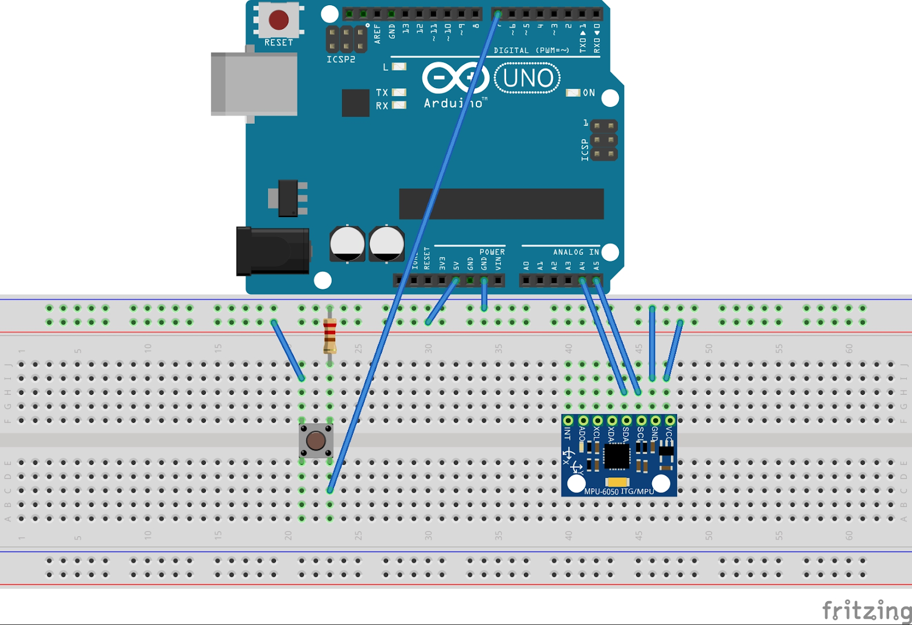

# Tilt-Controlled Breakout (Arduino + Processing)

**A version of the classic Breakout game where you move the paddle by tilting a motion sensor, built from an Arduino, an MPU-6050 sensor and a Processing game sketch.**

## What it does
Tilt the sensor left or right to move the paddle and break the 7 × 4 wall of bricks. A push button pauses, resumes and restarts the game.

## How it works
1. **Hardware:** Arduino Uno + GY-521 (MPU-6050) motion sensor + push button with a 10 kΩ resistor, wired on a breadboard (see `images/circuit_diagram.png`).
2. **Arduino:** reads the sensor's tilt over I²C, smooths it with a 16-sample moving average, and sends the values and button state over serial at 19,200 baud.
3. **Processing:** reads the serial stream, maps the tilt to the paddle position, and runs the game: ball physics, brick collisions, win and pause screens.

## Limitations
- Wired control.
- The sensor is very sensitive, which makes fine paddle control hard.
- **Next step:** add lives (lose after 3 dropped balls).

## Tools
Arduino Uno, MPU-6050 (GY-521), Arduino IDE (C++), Processing (Java), Fritzing for the circuit diagram

## My role
First-year physics project (B.Tech CSBS, Semester 1, 2022). Team of 4 per the report; I built the circuit and wrote the Arduino and Processing code. The sensor-reading and game logic were adapted from public tutorials, which are linked in the report.

## Folder contents
| Path | What it is |
|---|---|
| `report/Breakout_Game_Report.pdf` | Project report: components, wiring, full code, limitations |
| `code/arduino/breakoutgame.ino` | Arduino sketch that reads the sensor and sends serial data |
| `code/processing/BreakoutGame/` | Processing game sketch (+ font in `data/`) |
| `images/circuit_diagram.png` | Breadboard wiring diagram |

## How to run
1. Wire the circuit as in the diagram: SDA → A4, SCL → A5, button → pin 7.
2. Upload `breakoutgame.ino` from the Arduino IDE (needs the Bounce2 library).
3. Open `BreakoutGame.pde` in Processing. If the game doesn't respond, change `Serial.list()[2]` to your Arduino's port index, then run.

---
**Shubham Tanna** · Arduino (C++), Processing (Java), electronics
<!-- SITE_LINK:work -->
